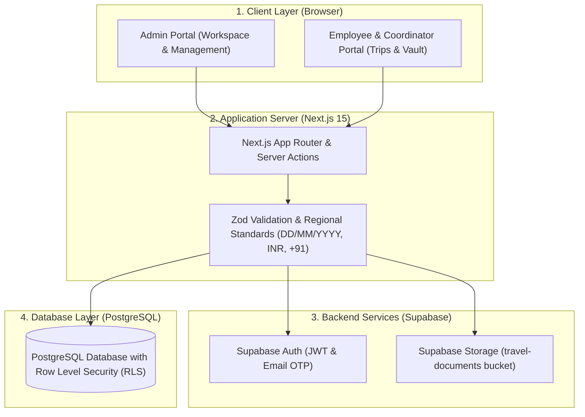
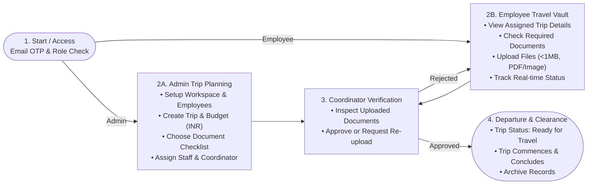

# TripBoard System Architecture & System Flowchart

This document provides balanced, report-ready Mermaid diagrams for the TripBoard project.

---

## 1. System Architecture (4-Tier Model)

---

## 2. System Flowchart (Compact Landscape Layout - Fits on 1 Page)

A clean, 16:9 landscape diagram structured across 4 key stages with vertically stacked operational lanes, designed specifically to fit on a single report page without vertical stretching.

